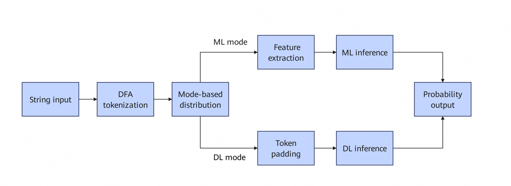

# API Reference

<!-- md-trans-meta sourceCommit=fe1b285cc2871a7cc7ccc5a933b8404d18154f2f translatedAt=2026-09-22T04:22:44.131Z pushedAt=2026-09-23T05:48:18.245Z -->

## Overview

The KADD SQL injection detection engine provides the following modules:

| Module | Header File | Function |
|------|--------|------|
| SQLi engine | `kadd_sqli_engine.h` | SQL injection detection (ML/DL dual mode) |
| DL engine | `kadd_dl_engine.h` | Unified DL/CNN inference (native SVE + ONNX fallback) |
| ML engine | `kadd_ml_engine.h` | Unified ML/RF inference (native SVE + ONNX fallback) |
| DFA engine | `kadd_dfa_engine.h` | String tokenization |
| Feature engine | `kadd_feature_engine.h` | Sequence-to-feature-vector conversion |
| Config | `kadd_config_loader.h` | Configuration loading |

### Processing Flow

The SQL injection detection engine processes input according to the following flowchart:



### Model Loading Strategy

Both the ML and DL engines use the same loading strategy:

1. When SVE is available, they first try to load the native binary format (`.krf`/`.kcn`).
2. If native format loading fails or SVE is unavailable, they fall back to ONNX Runtime to load the `.onnx` format.


## SQLi Engine APIs

### kadd_sqli_engine_create_from_file

**Function**

Creates a SQL injection detection engine from a configuration file. Selects ML or DL inference mode based on the `engine_mode` configuration.

**Function API**

```c
int kadd_sqli_engine_create_from_file(kadd_sqli_engine_t **engine, const char *config_file);
```

**Parameters**

* `engine`: pointer to the engine handle pointer.
* `config_file`: path to the JSON configuration file.

**Return Values**

Status code: `KADD_SUCCESS` indicates that the operation is successful, and a negative value indicates that the operation fails.


### kadd_sqli_detect

**Function**

Checks whether a single input is SQL injection.

**Function API**

```c
int kadd_sqli_detect(kadd_sqli_engine_t *engine, const char *input, float *probability);
```

**Parameters**

* `engine`: engine handle.
* `input`: input string.
* `probability`: output probability. The value range is [0, 1]. A larger value indicates a higher probability of SQL injection.

**Return Values**

Status code: `KADD_SUCCESS` indicates that the operation is successful, and a negative value indicates that the operation fails.


### kadd_sqli_detect_batch

**Function**

Batch checks multiple inputs.

**Function API**

```c
int kadd_sqli_detect_batch(kadd_sqli_engine_t *engine, const char **inputs,
                           int count, float *probabilities, int batch_size);
```

**Parameters**

* `engine`: engine handle.
* `inputs`: input string array.
* `count`: number of inputs.
* `probabilities`: output probability array.
* `batch_size`: inference batch size (`32`/`64`/`128` recommended; for a value less than or equal to 0 or greater than 1024, the default value `64` is automatically used).

**Return Values**

Status code: `KADD_SUCCESS` indicates that the operation is successful, and a negative value indicates that the operation fails.


### kadd_sqli_engine_free

**Function**

Releases engine resources. Passing `NULL` is safe.

**Function API**

```c
void kadd_sqli_engine_free(kadd_sqli_engine_t *engine);
```


## DL Engine APIs

### kadd_dl_model_load

**Function**

Loads a DL/CNN model. When SVE is available, it first tries the native CNN format (`.kcn`) and falls back to ONNX upon failure. When SVE is unavailable, it directly uses ONNX Runtime.

**Function API**

```c
int kadd_dl_model_load(kadd_dl_model_t **model, const char *model_path, int feature_dim);
```

**Parameters**

* `model`: pointer to the model handle pointer.
* `model_path`: model file path (`.kcn` native format or `.onnx`).
* `feature_dim`: feature dimension (`0` indicates reading it automatically from the model; when the value is greater than 0, it is verified against the model dimension).

**Return Values**

Status code: `KADD_SUCCESS` indicates that the operation is successful, and a negative value indicates that the operation fails.


### kadd_dl_model_predict

**Function**

Performs single-sample inference.

**Function API**

```c
int kadd_dl_model_predict(kadd_dl_model_t *model, const float *input, float *probability);
```

**Parameters**

* `model`: model handle.
* `input`: a 300-dimensional float token ID array for CNN; a `feature_dim`-dimensional float array for ONNX.
* `probability`: output probability of the positive class. The value range is [0, 1].

**Return Values**

Status code: `KADD_SUCCESS` indicates that the operation is successful, and a negative value indicates that the operation fails.


### kadd_dl_model_predict_batch

**Function**

Performs batch inference.

**Function API**

```c
int kadd_dl_model_predict_batch(kadd_dl_model_t *model, const float *inputs,
                                int n, float *probabilities, int batch_size);
```

**Parameters**

* `model`: model handle.
* `inputs`: input matrix (`n` × `input_dim`).
* `n`: number of samples.
* `probabilities`: output probability array.
* `batch_size`: batch size (when the value is less than or equal to 0 or greater than 1024, the default value `64` is automatically used).

**Return Values**

Status code: `KADD_SUCCESS` indicates that the operation is successful, and a negative value indicates that the operation fails.


### kadd_dl_model_get_feature_dim

**Function**

Obtains the input dimension (CNN: `300`; ONNX: read from the model).

**Function API**

```c
int kadd_dl_model_get_feature_dim(kadd_dl_model_t *model);
```


### kadd_dl_model_free

**Function**

Releases model resources. Passing `NULL` is safe.

**Function API**

```c
void kadd_dl_model_free(kadd_dl_model_t *model);
```


## ML Engine APIs

### kadd_model_load

**Function**

Loads an ML/RF model. When SVE is available, it first tries the native RF format (`.krf`) and falls back to ONNX Runtime upon failure. When SVE is unavailable, it directly uses ONNX Runtime.

**Function API**

```c
int kadd_model_load(kadd_model_handle_t **handle, const char *model_path, int feature_dim);
```

**Parameters**

* `handle`: pointer to the model handle pointer.
* `model_path`: model file path (`.krf` native format or `.onnx`).
* `feature_dim`: feature dimension (`0` indicates automatically reading the value from the model; a value greater than 0 indicates verifying the value against the model dimension).

**Return Values**

Status code: `KADD_SUCCESS` indicates that the operation is successful, and a negative value indicates that the operation fails.


### kadd_model_predict

**Function**

Performs single-sample inference.

**Function API**

```c
int kadd_model_predict(kadd_model_handle_t *handle,
                       const float *features, float *probability);
```

**Parameters**

* `handle`: model handle.
* `features`: feature vector.
* `probability`: output probability. The value range is [0, 1].

**Return Values**

Status code: `KADD_SUCCESS` indicates that the operation is successful, and a negative value indicates that the operation fails.


### kadd_model_predict_batch

**Function**

Performs batch inference (block-based processing).

**Function API**

```c
int kadd_model_predict_batch(kadd_model_handle_t *handle, const float *features,
                             int n, float *probabilities, int batch_size);
```

**Parameters**

* `handle`: model handle.
* `features`: feature matrix (*n* × `feature_dim`).
* `n`: number of samples (It is recommended that the value be determined based on the actual memory. The recommended value is less than 10,000,000.)
* `probabilities`: output probability array.
* `batch_size`: batch size (`32`/`64`/`128` recommended; for a value less than or equal to 0 or greater than 1024, the default value `64` is automatically used).

**Return Values**

Status code: `KADD_SUCCESS` indicates that the operation is successful, and a negative value indicates that the operation fails.

**Precautions**

* If `batch_size` is less than or equal to 0 or greater than 1024, the default value `64` is used automatically.
* If any batch processing fails, the corresponding error code is returned immediately, and partial success does not occur.


### kadd_model_get_feature_dim

**Function**

Obtains the model feature dimension.

**Function API**

```c
int kadd_model_get_feature_dim(kadd_model_handle_t *handle);
```


### kadd_model_free

**Function**

Releases model resources. Passing `NULL` is safe.

**Function API**

```c
void kadd_model_free(kadd_model_handle_t *handle);
```


## DFA Engine APIs

### kadd_dfa_engine_create

**Function**

Creates a DFA tokenization engine.

**Function API**

```c
int kadd_dfa_engine_create(kadd_dfa_engine_t **engine,
                           const kadd_dfa_table_paths_t *table_paths,
                           size_t max_input_chars,
                           size_t max_tokens);
```

**Parameters**

* `engine`: pointer to the engine handle pointer.
* `table_paths`: structure of the paths to the three DFA tables.
* `max_input_chars`: maximum number of input SQL characters, which must be greater than 0.
* `max_tokens`: maximum number of output tokens, which must be greater than 0.

**Return Values**

Status code: `KADD_SUCCESS` indicates that the operation is successful, and a negative value indicates that the operation fails.


### kadd_dfa_engine_tokenize

**Function**

Tokenizes the input string.

**Function API**

```c
int kadd_dfa_engine_tokenize(const kadd_dfa_engine_t *engine,
                             const char *input,
                             size_t input_length,
                             int *output,
                             int *token_count);
```

**Parameters**

* `engine`: engine handle.
* `input`: input string.
* `input_length`: length of the input string.
* `output`: output token index array.
* `token_count`: number of output tokens.

**Return Values**

Status code: `KADD_SUCCESS` indicates that the operation is successful, and a negative value indicates that the operation fails.


### kadd_dfa_engine_tokenize_batch

**Function**

Batch tokenizes multiple strings.

**Function API**

```c
int kadd_dfa_engine_tokenize_batch(const kadd_dfa_engine_t *engine,
                                   kadd_dfa_batch_t *batch);
```

**Parameters**

* `engine`: engine handle.
* `batch`: batch processing context structure, including:
* `inputs`: input string array.
* `lengths`: length array.
* `count`: number of inputs.
* `outputs`: output token array.
* `dims`: number of tokens for each string.
* `batch_size`: batch size. (`0` or a negative value indicates that the default value `64` is used.)

**Return Values**

Status code: `KADD_SUCCESS` indicates that the operation is successful, and a negative value indicates that the operation fails.

**Precautions**

If any input fails, an error is returned immediately, and partial success does not occur.


### kadd_dfa_engine_free

**Function**

Releases DFA engine resources. Passing `NULL` is safe.

**Function API**

```c
void kadd_dfa_engine_free(kadd_dfa_engine_t *engine);
```


## Feature Engine APIs

### kadd_seq_to_feature

**Function**

Converts a token sequence into a fixed-dimensional feature vector.

**Function API**

```c
int kadd_seq_to_feature(const int *seq, int seq_len, int window_size,
                        int *feature, int feature_dim);
```

**Parameters**

* `seq`: input sequence.
* `seq_len`: sequence length.
* `window_size`: sliding window size.
* `feature`: output feature vector.
* `feature_dim`: number of the output feature dimensions.

**Return Values**

Status code: `KADD_SUCCESS` indicates that the operation is successful, and a negative value indicates that the operation fails.


### kadd_seq_to_feature_batch

**Function**

Batch converts token sequences into feature vectors.

**Function API**

```c
int kadd_seq_to_feature_batch(kadd_feature_batch_t *batch);
```

**Parameters**

* `batch`: batch processing context structure, including:
* `seqs`: token sequence array.
* `seq_lens`: sequence length array.
* `count`: number of sequences.
* `features`: output features.
* `feature_dim`: number of the feature dimensions.
* `window_size`: sliding window size.
* `batch_size`: batch size. (`0` or a negative value indicates that the default value `64` is used.)

**Return Values**

Status code: `KADD_SUCCESS` indicates that the operation is successful, and a negative value indicates that the operation fails.

**Precautions**

If any sequence fails to be converted, an error is returned immediately, and partial success does not occur.


## Configuration Loading APIs

### kadd_config_load

**Function**

Loads all engine configurations from the configuration file.

**Function API**

```c
int kadd_config_load(const char *config_path, kadd_config_t *config);
```

**Parameters**

* `config_path`: configuration file path.
* `config`: output configuration structure.

**Return Values**

Status code: `KADD_SUCCESS` indicates that the operation is successful, and a negative value indicates that the operation fails.


### kadd_config_free

**Function**

Releases configuration resources. Passing `NULL` is safe.

**Function API**

```c
void kadd_config_free(kadd_config_t *config);
```


## Error Codes

As a top-level module, the SQLi engine does not define error codes separately. When an error occurs, it directly returns the underlying sub-engine error code or a common error code.

| Error Code | Macro | Module | Description |
|--------|----|------|------|
| 0 | `KADD_SUCCESS` | Common | Success |
| -101 | `KADD_ERROR_INVALID_INPUT` | Common | Invalid input |
| -102 | `KADD_ERROR_NULL_PTR` | Common | Null pointer |
| -103 | `KADD_ERROR_OUT_OF_MEMORY` | Common | Out of memory |
| -104 | `KADD_ERROR_NOT_INIT` | Common | Engine not initialized |
| -105 | `KADD_ERROR_INVALID_PARAM` | Common | Invalid parameter |
| -107 | `KADD_ERROR_MODEL_LOAD_FAILED` | Common | Model loading failure |
| -108 | `KADD_ERROR_FILE_OPERATION_FAILED` | Common | File operation failure |
| -109 | `KADD_ERROR_CONFIG` | Common | Configuration file error or missing required field |
| -110 | `KADD_ERROR_INFERENCE_FAILED` | Common | Model inference failure |
| -10 | `KADD_DFA_ERROR_FILE_NOT_FOUND` | DFA | DFA file not found |
| -11 | `KADD_DFA_ERROR_PARSE` | DFA | DFA file parsing failure |
| -12 | `KADD_DFA_ERROR_BUFFER_OVERFLOW` | DFA | DFA buffer overflow |
| -13 | `KADD_DFA_ERROR_INVALID_LENGTH` | DFA | Invalid DFA input length |
| -200 | `KADD_FEATURE_ERROR_VALUE_OUT_OF_RANGE` | Feature | Feature sequence element value out of range |

**For detailed definitions, see the source header file** `/opt/KADD/SQLi/include/kadd_errors.h`.


## Header File Paths

| Header File | Path | Description |
|--------|------|------|
| `kadd_sqli_engine.h` | `/opt/KADD/SQLi/include/` | SQLi engine (public) |
| `kadd_dl_engine.h` | `/opt/KADD/SQLi/include/` | DL engine (public) |
| `kadd_ml_engine.h` | `/opt/KADD/SQLi/include/` | ML engine (public) |
| `kadd_errors.h` | `/opt/KADD/SQLi/include/` | Error code (public) |
| `kadd_dfa_engine.h` | `/opt/KADD/SQLi/include/` | DFA engine (public) |
| `kadd_feature_engine.h` | `/opt/KADD/SQLi/include/` | Feature engine (public) |
| `kadd_config_loader.h` | `/opt/KADD/SQLi/include/` | Configuration loading (public) |
| `kadd_sve.h` | `/opt/KADD/SQLi/include/internal/` | SVE detection (internal) |
| `kadd_cnn_engine.h` | `/opt/KADD/SQLi/include/internal/` | CNN native engine (internal) |
| `kadd_rf_engine.h` | `/opt/KADD/SQLi/include/internal/` | RF native engine (internal) |
| `kadd_inference_engine.h` | `/opt/KADD/SQLi/include/internal/` | ONNX inference engine (internal) |
