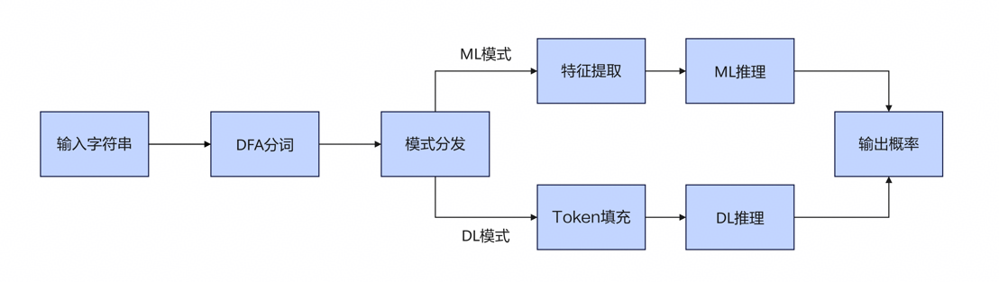

# API参考手册

## 概述

KADD SQL注入检测引擎提供以下模块：

| 模块 | 头文件 | 功能 |
|------|--------|------|
| SQLi引擎 | `kadd_sqli_engine.h` | SQL注入检测（ML/DL双模式） |
| DL引擎 | `kadd_dl_engine.h` | 统一DL/CNN推理（SVE原生 + ONNX回退） |
| ML引擎 | `kadd_ml_engine.h` | 统一ML/RF推理（SVE原生 + ONNX回退） |
| DFA引擎 | `kadd_dfa_engine.h` | 字符串分词 |
| Feature引擎 | `kadd_feature_engine.h` | 序列转特征向量 |
| Config | `kadd_config_loader.h` | 配置加载 |

### 处理流程

SQL注入检测引擎运行时会按照以下流程图处理输入：



### 模型加载策略

ML和DL引擎均采用相同的加载策略：

1. SVE可用时，优先尝试加载原生二进制格式（`.krf` / `.kcn`）
2. 原生格式加载失败或SVE不可用时，回退ONNX Runtime加载`.onnx`格式

---

## SQLi引擎API

### kadd_sqli_engine_create_from_file

**功能**

从配置文件创建SQL注入检测引擎。根据`engine_mode`配置选择ML或DL推理模式。

**函数接口**

```c
int kadd_sqli_engine_create_from_file(kadd_sqli_engine_t **engine, const char *config_file);
```

**参数**

* `engine`：引擎句柄指针的指针
* `config_file`：JSON配置文件路径

**返回值**

状态码：`KADD_SUCCESS`表示成功，负值表示失败

---

### kadd_sqli_detect

**功能**

检测单个输入是否为SQL注入。

**函数接口**

```c
int kadd_sqli_detect(kadd_sqli_engine_t *engine, const char *input, float *probability);
```

**参数**

* `engine`：引擎句柄
* `input`：输入字符串
* `probability`：输出概率 [0, 1]，值越大越可能是SQL注入

**返回值**

状态码：`KADD_SUCCESS`表示成功，负值表示失败

---

### kadd_sqli_detect_batch

**功能**

批量检测多个输入。

**函数接口**

```c
int kadd_sqli_detect_batch(kadd_sqli_engine_t *engine, const char **inputs,
                           int count, float *probabilities, int batch_size);
```

**参数**

* `engine`：引擎句柄
* `inputs`：输入字符串数组
* `count`：输入数量
* `probabilities`：输出概率数组
* `batch_size`：推理批次大小（推荐32/64/128；小于等于0或大于1024时自动使用默认值64）

**返回值**

状态码：`KADD_SUCCESS`表示成功，负值表示失败

---

### kadd_sqli_engine_free

**功能**

释放引擎资源。传入NULL安全。

**函数接口**

```c
void kadd_sqli_engine_free(kadd_sqli_engine_t *engine);
```

---

## DL引擎API

### kadd_dl_model_load

**功能**

加载DL/CNN模型。SVE可用时先尝试原生CNN格式（`.kcn`），失败回退ONNX。SVE不可用时直接使用ONNX Runtime。

**函数接口**

```c
int kadd_dl_model_load(kadd_dl_model_t **model, const char *model_path, int feature_dim);
```

**参数**

* `model`：模型句柄指针的指针
* `model_path`：模型文件路径（`.kcn`原生格式或`.onnx`）
* `feature_dim`：特征维度（0表示从模型自动读取；大于0时校验与模型维度是否一致）

**返回值**

状态码：`KADD_SUCCESS`表示成功，负值表示失败

---

### kadd_dl_model_predict

**功能**

单样本推理。

**函数接口**

```c
int kadd_dl_model_predict(kadd_dl_model_t *model, const float *input, float *probability);
```

**参数**

* `model`：模型句柄
* `input`：CNN为300维float token ID数组；ONNX为feature_dim维float数组
* `probability`：输出正类概率 [0, 1]

**返回值**

状态码：`KADD_SUCCESS`表示成功，负值表示失败

---

### kadd_dl_model_predict_batch

**功能**

批量推理。

**函数接口**

```c
int kadd_dl_model_predict_batch(kadd_dl_model_t *model, const float *inputs,
                                int n, float *probabilities, int batch_size);
```

**参数**

* `model`：模型句柄
* `inputs`：输入矩阵 (n x input_dim)
* `n`：样本数
* `probabilities`：输出概率数组
* `batch_size`：批次大小（<=0或>1024时自动使用默认值64）

**返回值**

状态码：`KADD_SUCCESS`表示成功，负值表示失败

---

### kadd_dl_model_get_feature_dim

**功能**

获取输入维度（CNN: 300；ONNX: 从模型读取）。

**函数接口**

```c
int kadd_dl_model_get_feature_dim(kadd_dl_model_t *model);
```

---

### kadd_dl_model_free

**功能**

释放模型资源。传入NULL安全。

**函数接口**

```c
void kadd_dl_model_free(kadd_dl_model_t *model);
```

---

## ML引擎API

### kadd_model_load

**功能**

加载ML/RF模型。SVE可用时先尝试原生RF格式（`.krf`），失败回退ONNX Runtime。SVE不可用时直接使用ONNX Runtime。

**函数接口**

```c
int kadd_model_load(kadd_model_handle_t **handle, const char *model_path, int feature_dim);
```

**参数**

* `handle`：模型句柄指针的指针
* `model_path`：模型文件路径（`.krf`原生格式或`.onnx`）
* `feature_dim`：特征维度（0=从模型自动读取；>0=校验与模型维度是否一致）

**返回值**

状态码：`KADD_SUCCESS`表示成功，负值表示失败

---

### kadd_model_predict

**功能**

单样本推理。

**函数接口**

```c
int kadd_model_predict(kadd_model_handle_t *handle,
                       const float *features, float *probability);
```

**参数**

* `handle`：模型句柄
* `features`：特征向量
* `probability`：输出概率 [0, 1]

**返回值**

状态码：`KADD_SUCCESS`表示成功，负值表示失败

---

### kadd_model_predict_batch

**功能**

批量推理（分块处理）。

**函数接口**

```c
int kadd_model_predict_batch(kadd_model_handle_t *handle, const float *features,
                             int n, float *probabilities, int batch_size);
```

**参数**

* `handle`：模型句柄
* `features`：特征矩阵 (n x feature_dim)
* `n`：样本数（建议根据实际内存判断，建议10,000,000以下）
* `probabilities`：输出概率数组
* `batch_size`：批次大小（推荐值：32/64/128；小于等于0或大于1024时自动使用默认值64）

**返回值**

状态码：`KADD_SUCCESS`表示成功，负值表示失败

**注意事项**

* 如果 `batch_size` 小于等于0或大于1024，将自动使用默认值64
* 任何批次处理失败会立即返回对应错误码，不会部分成功

---

### kadd_model_get_feature_dim

**功能**

获取模型特征维度。

**函数接口**

```c
int kadd_model_get_feature_dim(kadd_model_handle_t *handle);
```

---

### kadd_model_free

**功能**

释放模型资源。传入NULL安全。

**函数接口**

```c
void kadd_model_free(kadd_model_handle_t *handle);
```

---

## DFA引擎API

### kadd_dfa_engine_create

**功能**

创建DFA分词引擎。

**函数接口**

```c
int kadd_dfa_engine_create(kadd_dfa_engine_t **engine,
                           const kadd_dfa_table_paths_t *table_paths,
                           size_t max_input_chars,
                           size_t max_tokens);
```

**参数**

* `engine`：引擎句柄指针的指针
* `table_paths`：DFA三张表路径结构体
* `max_input_chars`：最大输入SQL字符数，必须大于0
* `max_tokens`：最大token输出数量，必须大于0

**返回值**

状态码：`KADD_SUCCESS`表示成功，负值表示失败

---

### kadd_dfa_engine_tokenize

**功能**

对输入字符串进行分词。

**函数接口**

```c
int kadd_dfa_engine_tokenize(const kadd_dfa_engine_t *engine,
                             const char *input,
                             size_t input_length,
                             int *output,
                             int *token_count);
```

**参数**

* `engine`：引擎句柄
* `input`：输入字符串
* `input_length`：输入字符串长度
* `output`：输出token索引数组
* `token_count`：输出实际token数量

**返回值**

状态码：`KADD_SUCCESS`表示成功，负值表示失败

---

### kadd_dfa_engine_tokenize_batch

**功能**

批量分词多个字符串。

**函数接口**

```c
int kadd_dfa_engine_tokenize_batch(const kadd_dfa_engine_t *engine,
                                   kadd_dfa_batch_t *batch);
```

**参数**

* `engine`：引擎句柄
* `batch`：批处理上下文结构体，包含：
* `inputs`：输入字符串数组
* `lengths`：长度数组
* `count`：输入数量
* `outputs`：输出token数组
* `dims`：每个的token数量
* `batch_size`：批次大小（0或负数表示默认64）

**返回值**

状态码：`KADD_SUCCESS`表示成功，负值表示失败

**注意事项**

任何输入失败都会立即返回错误，不会部分成功。

---

### kadd_dfa_engine_free

**功能**

释放DFA引擎资源。传入NULL安全。

**函数接口**

```c
void kadd_dfa_engine_free(kadd_dfa_engine_t *engine);
```

---

## Feature引擎API

### kadd_seq_to_feature

**功能**

将Token序列转换为固定维度特征向量。

**函数接口**

```c
int kadd_seq_to_feature(const int *seq, int seq_len, int window_size,
                        int *feature, int feature_dim);
```

**参数**

* `seq`：输入序列
* `seq_len`：序列长度
* `window_size`：滑动窗口大小
* `feature`：输出特征向量
* `feature_dim`：输出特征维度

**返回值**

状态码：`KADD_SUCCESS`表示成功，负值表示失败

---

### kadd_seq_to_feature_batch

**功能**

批量将token序列转换为特征向量。

**函数接口**

```c
int kadd_seq_to_feature_batch(kadd_feature_batch_t *batch);
```

**参数**

* `batch`：批处理上下文结构体，包含：
* `seqs`：token序列数组
* `seq_lens`：序列长度数组
* `count`：序列数量
* `features`：输出特征
* `feature_dim`：特征维度
* `window_size`：滑动窗口大小
* `batch_size`：批次大小（0或负数表示默认64）

**返回值**

状态码：`KADD_SUCCESS`表示成功，负值表示失败

**注意事项**

任何序列失败都会立即返回错误，不会部分成功。

---

## 配置加载API

### kadd_config_load

**功能**

从配置文件加载所有引擎配置。

**函数接口**

```c
int kadd_config_load(const char *config_path, kadd_config_t *config);
```

**参数**

* `config_path`：配置文件路径
* `config`：输出配置结构体

**返回值**

状态码：`KADD_SUCCESS`表示成功，负值表示失败

---

### kadd_config_free

**功能**

释放配置资源。传入NULL安全。

**函数接口**

```c
void kadd_config_free(kadd_config_t *config);
```

---

## 错误码

SQLi引擎作为顶层模块不单独定义错误码，错误发生时直接返回底层子引擎错误码或公共错误码。

| 错误码 | 宏 | 模块 | 说明 |
|--------|----|------|------|
| 0 | `KADD_SUCCESS` | 通用 | 成功 |
| -101 | `KADD_ERROR_INVALID_INPUT` | 通用 | 无效输入 |
| -102 | `KADD_ERROR_NULL_PTR` | 通用 | 空指针 |
| -103 | `KADD_ERROR_OUT_OF_MEMORY` | 通用 | 内存不足 |
| -104 | `KADD_ERROR_NOT_INIT` | 通用 | 引擎未初始化 |
| -105 | `KADD_ERROR_INVALID_PARAM` | 通用 | 无效参数 |
| -107 | `KADD_ERROR_MODEL_LOAD_FAILED` | 通用 | 模型加载失败 |
| -108 | `KADD_ERROR_FILE_OPERATION_FAILED` | 通用 | 文件操作失败 |
| -109 | `KADD_ERROR_CONFIG` | 通用 | 配置文件错误或缺失必需字段 |
| -110 | `KADD_ERROR_INFERENCE_FAILED` | 通用 | 模型推理失败 |
| -10 | `KADD_DFA_ERROR_FILE_NOT_FOUND` | DFA | DFA文件未找到 |
| -11 | `KADD_DFA_ERROR_PARSE` | DFA | DFA文件解析失败 |
| -12 | `KADD_DFA_ERROR_BUFFER_OVERFLOW` | DFA | DFA缓冲区溢出 |
| -13 | `KADD_DFA_ERROR_INVALID_LENGTH` | DFA | DFA输入长度无效 |
| -200 | `KADD_FEATURE_ERROR_VALUE_OUT_OF_RANGE` | Feature | Feature序列元素超出范围 |

**详细定义请参考源码头文件** `/opt/KADD/SQLi/include/kadd_errors.h`

---

## 头文件路径

| 头文件 | 路径 | 说明 |
|--------|------|------|
| `kadd_sqli_engine.h` | `/opt/KADD/SQLi/include/` | SQLi引擎（公开） |
| `kadd_dl_engine.h` | `/opt/KADD/SQLi/include/` | DL引擎（公开） |
| `kadd_ml_engine.h` | `/opt/KADD/SQLi/include/` | ML引擎（公开） |
| `kadd_errors.h` | `/opt/KADD/SQLi/include/` | 错误码（公开） |
| `kadd_dfa_engine.h` | `/opt/KADD/SQLi/include/` | DFA引擎（公开） |
| `kadd_feature_engine.h` | `/opt/KADD/SQLi/include/` | Feature引擎（公开） |
| `kadd_config_loader.h` | `/opt/KADD/SQLi/include/` | 配置加载（公开） |
| `kadd_sve.h` | `/opt/KADD/SQLi/include/internal/` | SVE检测（内部） |
| `kadd_cnn_engine.h` | `/opt/KADD/SQLi/include/internal/` | CNN原生引擎（内部） |
| `kadd_rf_engine.h` | `/opt/KADD/SQLi/include/internal/` | RF原生引擎（内部） |
| `kadd_inference_engine.h` | `/opt/KADD/SQLi/include/internal/` | ONNX推理引擎（内部） |
